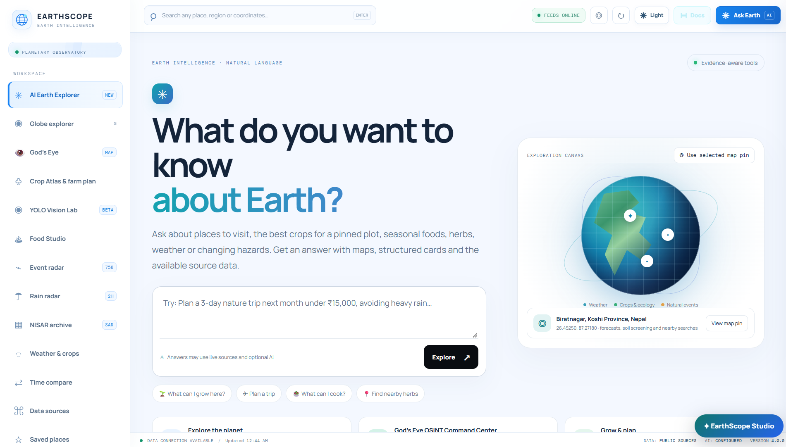
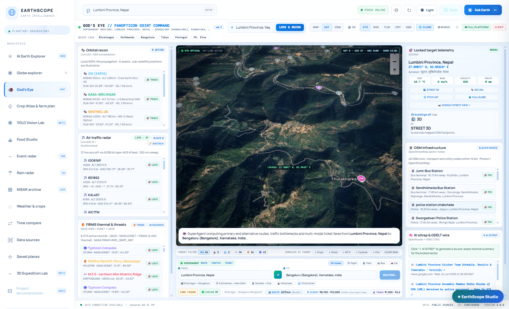
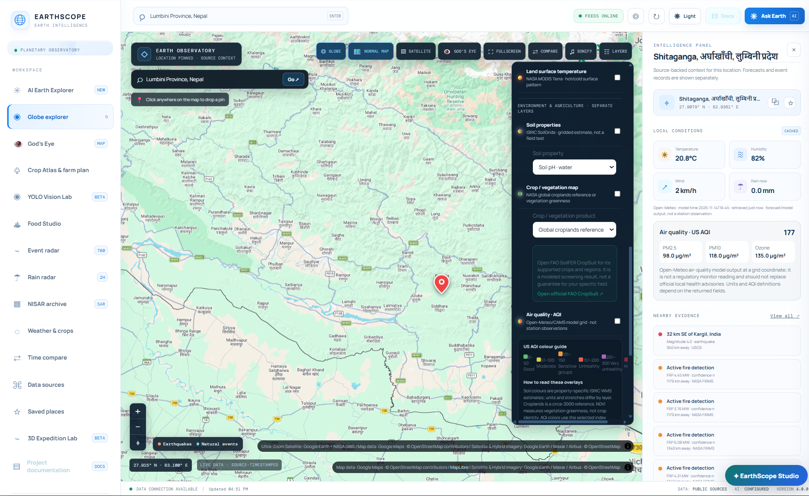
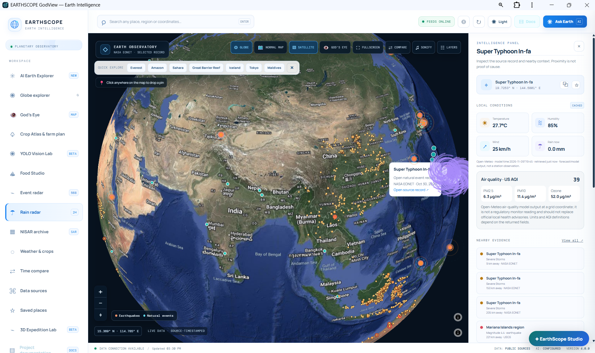
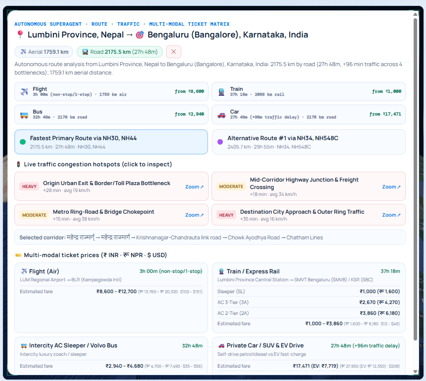
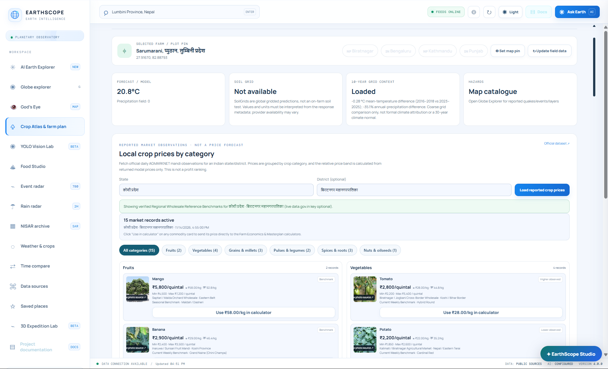
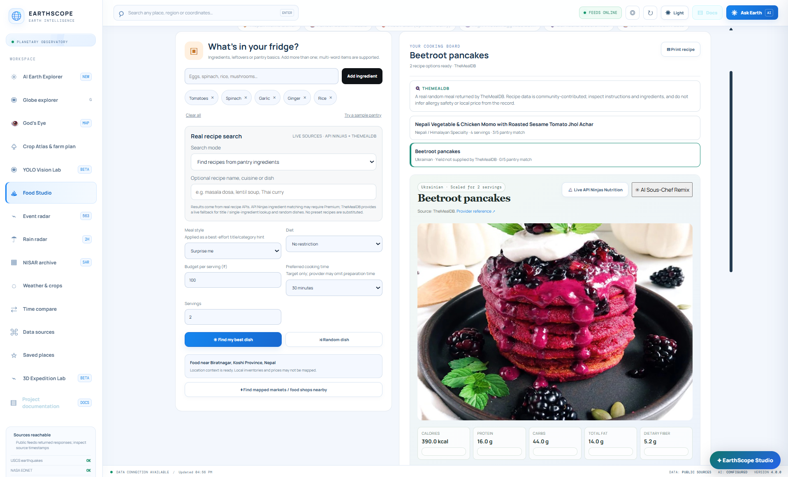
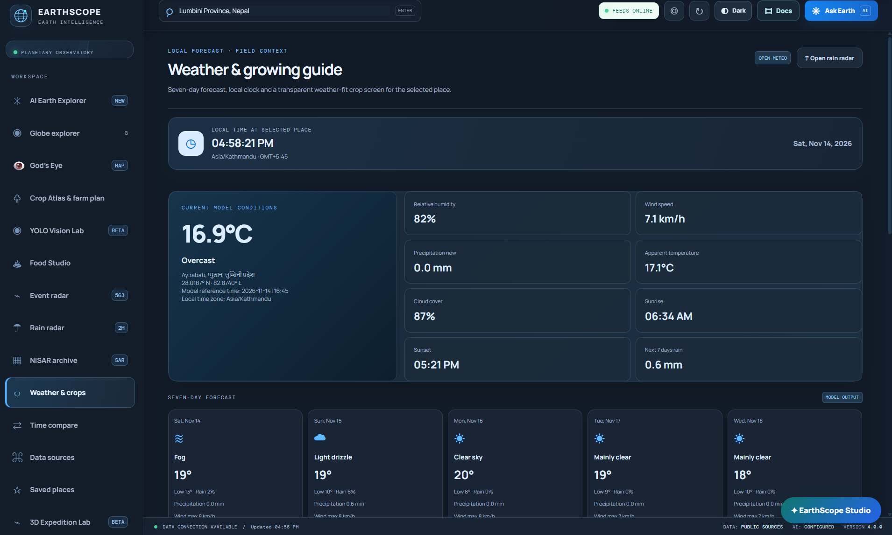
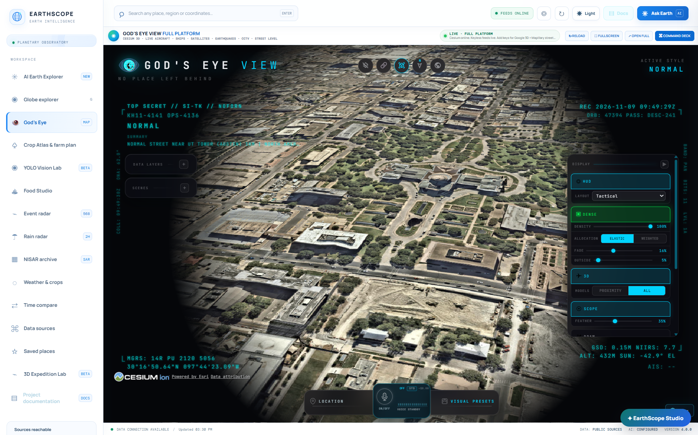

<div align="center">


# EARTHSCOPE GodView

**Earth intelligence, farm planning and an OSINT command centre — in one PHP app.**

**Live demo: [earthscope.yantraiot.com](https://earthscope.yantraiot.com)**

Live satellite imagery, NASA hazards, air quality, crop prices, recipes, 3D expedition races,
and a tactical "God's Eye" recon HUD. No build step, no framework, no database server required.

[](https://www.php.net/)
[](#quick-start)
[](#)
[](LICENSE)
[](https://earthscope.yantraiot.com)



</div>

> **Try it live:** [earthscope.yantraiot.com](https://earthscope.yantraiot.com) — source code for
> that deployment is in [Releases](../../releases).

<div align="center">

### Watch the 45-second product tour

<a href="docs/video/earthscope-demo.mp4">
  
</a>

**[▶ Play the demo video](docs/video/earthscope-demo.mp4)** (45 s, 1080p, 21 MB)

</div>

---

## What this is

A single-page geospatial workspace that runs on ordinary shared hosting. Drop the files in a web
root, open the site, and you get a globe you can interrogate: pin any coordinate and the app pulls
weather, air quality, soil, hazards, crop prices, nearby infrastructure and news for that spot.

Everything goes through one PHP endpoint (`api.php`) so API keys never reach the browser. The
front end is plain ES modules and CSS — there is nothing to compile.

**Not affiliated with NASA.** It consumes public NASA and other open APIs; see
[Data sources](#data-sources).

---

## Screens

<table>
<tr>
<td width="50%"><br><sub><b>Globe explorer</b> — pin a place, get weather, AQI, soil, hazards and nearby evidence in one panel.</sub></td>
<td width="50%"><br><sub><b>Satellite + hazards</b> — EONET storms, USGS quakes, FIRMS fire detections on a 3D globe.</sub></td>
</tr>
<tr>
<td width="50%"><br><sub><b>God's Eye command centre</b> — orbital recon, ADS-B radar, FIRMS threats, locked-target telemetry, routing.</sub></td>
<td width="50%"><br><sub><b>Route + ticket matrix</b> — flight, rail, bus and car fare bands with congestion hotspots.</sub></td>
</tr>
<tr>
<td width="50%"><br><sub><b>Crop atlas</b> — climate fit, soil grid, AGMARKNET mandi prices grouped by category, unit economics.</sub></td>
<td width="50%"><br><sub><b>Food Studio</b> — pantry in, recipes out, with nutrition and per-serving budget.</sub></td>
</tr>
<tr>
<td width="50%"><br><sub><b>Weather &amp; crops</b> — local clock, current model conditions, 7-day forecast, crop-fit screen.</sub></td>
<td width="50%"><br><sub><b>Full God's Eye platform</b> — optional Cesium viewer embedded via <code>godseyePlatformUrl</code>.</sub></td>
</tr>
</table>

---

## NASA Space Apps Challenge 2026

Built for **Challenge 7 / Field Shift — Adapting Farms with NASA Data**, as **Team NExHunter**.

**One planet. Multiple evidence sources. Clearer decisions.** A farm decision needs more than a
weather snapshot: climate history, soil properties, crop envelopes, water context and market signals
each answer different questions — and usually live in different places. EARTHSCOPE joins them into
one pin-first evidence board where every signal keeps its own source and evidence type.

The submission deck (7 pages, product framing, screenshots, architecture, and the full team) is here:

**[📄 EARTHSCOPE — NASA Space Apps Challenge 2026 deck (PDF)](docs/deck/EARTHSCOPE-NASA-Space-Apps-2026.pdf)**

<div align="center">
  <a href="docs/deck/EARTHSCOPE-NASA-Space-Apps-2026.pdf">
    
  </a>
</div>

### How it was built

```
01  Open sources        NASA + partner feeds (GIBS, POWER, EONET, FIRMS, CMR/NISAR)
02  PHP API layer       fetch · normalise · cache · rate-limit
03  Geo visualisation   MapLibre · Cesium · Three.js
04  Evidence + tools    source tags · crop screening · optional AI
```

PHP 8.x · JavaScript ES6 · MapLibre GL JS · Three.js · Cesium · SQLite / MySQL · PWA.
Open-Meteo is primary for climate history; NASA POWER is the fallback.

### What the Crop Atlas actually does

617 crop and plant records, screened on a transparent 0–100 index:

| Input | Weight |
|---|---|
| Temperature | 45% |
| Precipitation | 30% |
| Soil context | 15% |
| Water context | 10% |

Climate history + FAO EcoCrop envelopes + SoilGrids estimates + water inputs → screening index.

> **Honest limits, by design.** This is not a yield forecast or a harvest guarantee. SoilGrids is
> gridded model output, not field measurement. Mandi prices are wholesale observations, not
> farm-gate offers. Reported records and provider coverage are not a certified emergency-warning
> system, and NISAR access is catalogue metadata discovery only.

### Team NExHunter — six contributors

| | Role |
|---|---|
| **Aadiya Shah** | Team lead · full-stack developer |
| Ankit Shah | Head researcher · idea & presentation |
| Raghavendra Kumar Mahato | Researcher · data analyst |
| Anik Mandal | Developer · system integration |
| Piyush Jha | Testing · bug resolution |
| Agshish Kumar Sah | QA · testing & deployment |

**Measured ≠ Modelled ≠ AI-interpreted.** Explore the Earth. Understand the evidence. Empower decisions.

---

## Features

| Workspace | What it does |
|---|---|
| **AI Earth Explorer** | Ask a question in plain language. The app picks the workspace, builds the map context and returns an answer with source cards. Uses OpenRouter when a key is set; without one it degrades to deterministic source lookups. |
| **Globe explorer** | Globe / 2D / normal / satellite modes, quick-explore presets (Everest, Amazon, Sahara, Great Barrier Reef, Iceland, Tokyo, Maldives, …), click-to-pin, and an intelligence panel with weather, US-AQI, soil, cropland and nearby events. |
| **God's Eye** | Tactical HUD with STD / NVG / FLIR / CRT / SAR shader modes, orbital catalogue (ISS, NISAR, Sentinel-2, Starlink, Galileo), live ADS-B aircraft, AIS vessels, OSM infrastructure scan (police, hospitals, malls, stations), Wikimedia imagery, news, AQI, and a multi-modal route + fare matrix. |
| **Crop Atlas & farm plan** | Crop families, climate-fit screening against NASA POWER history, ISRIC SoilGrids properties, AGMARKNET reported mandi prices by state / district / category, cost-per-unit calculator, printable A4 field report. |
| **Food Studio** | Pantry-to-recipe search (TheMealDB), nutrition lookup (API Ninjas), servings/budget scaling, seasonal ideas, nearby market hints. |
| **Event radar** | NASA EONET events, USGS earthquakes, GDACS disasters, FIRMS thermal anomalies, InciWeb fire perimeters, flood forecast. |
| **Rain radar / NISAR archive / Weather & crops / Time compare** | RainViewer radar frames, NASA NISAR CMR granule search, Open-Meteo forecasts and 10-year climate context, side-by-side place comparison. |
| **3D Expedition Lab** | Drive, fly or race over real satellite imagery and terrain. Six vehicles, three game modes, online multiplayer rooms and a race leaderboard stored in SQLite or MySQL. |
| **YOLO Vision Lab** *(beta)* | Browser-side YOLO26n object detection. Images are inferred on the visitor's machine and never uploaded. |
| **Saved places / Data sources / Docs** | Server-side saved coordinates, a live source catalogue with status, and built-in troubleshooting documentation. |

Also included: installable PWA with a service worker, light/dark themes, CSRF-protected writes,
per-IP file-based rate limiting, and server-side response caching.

---

## Quick start

### Requirements

- **PHP 8.2+** with `curl`, `json`, `openssl` and either `pdo_sqlite` (default) or `pdo_mysql`
- Apache with `mod_rewrite` and `mod_headers` (the bundled `.htaccess`), or nginx with equivalent rules
- Write access to `storage/cache`, `storage/ratelimit`, `storage/db`
- That's it. No Composer, no npm, no build.

### 1. Upload

Unzip so the **contents** land in your web root — `index.php`, `config.php`, `api.php` and
`assets/` must sit together:

```
public_html/
├── index.php
├── api.php
├── config.php
├── config.local.php      ← your keys live here (blank by default)
├── assets/
├── storage/
└── ...
```

### 2. Permissions

```bash
chmod -R 775 storage
```

`storage/` holds the cache, the rate-limit state and the SQLite database. The bundled
`storage/*/.htaccess` files block web access to it — keep them.

### 3. Add your API keys

Open `config.local.php` and fill in whichever keys you have. Every key is optional; the app tells
you which layers are disabled instead of failing.

### 4. Verify

Open `https://your-domain/health.php`. It reports PHP version, extensions, config load state,
storage permissions and database driver **without printing secrets**. Then open the site.

### Local development

```bash
php -S localhost:8000
```

Then browse `http://localhost:8000`. `health.php` works the same way.

---

## API keys — what each one unlocks

All keys are read server-side only. Nothing is exposed to browser JavaScript, and `config.local.php`
is denied by `.htaccess`.

| Key in `config.local.php` | Unlocks | Where to get it | Free tier |
|---|---|---|---|
| `openrouter_api_key` | Ask Earth answers, AI Explorer routing, vision, TTS and speech-to-text | [openrouter.ai/keys](https://openrouter.ai/keys) | Free models available (`openrouter/free`) |
| `firms_map_key` | NASA FIRMS active fire / thermal anomaly detections | [firms.modaps.eosdis.nasa.gov/api/map_key](https://firms.modaps.eosdis.nasa.gov/api/map_key/) | Free, instant |
| `data_gov_in_api_key` | AGMARKNET mandi crop prices (state → district → category) | [data.gov.in](https://data.gov.in/) → register → *My Account → API key* | Free |
| `api_ninjas_api_key` | Nutrition facts and premium recipe matching in Food Studio | [api-ninjas.com/profile](https://api-ninjas.com/profile) | Free tier, rate-limited |
| `aviationstack_api_key` | Flight metadata enrichment in the God's Eye radar | [aviationstack.com](https://aviationstack.com/) | Small free tier |
| `themealdb_api_key` | Recipe search. Ships as `'1'`, the public dev key | [themealdb.com/api.php](https://www.themealdb.com/api.php) | Dev key free |

### Step by step

1. **OpenRouter** — sign in → *Keys* → **Create Key** → copy the `sk-or-v1-…` value into
   `openrouter_api_key`. Pick a model in `openrouter_model`; `openrouter/free` routes across free
   models. Add credits if you want the paid vision/TTS models.
2. **NASA FIRMS** — request a MAP_KEY from the link above (email only, arrives instantly) → paste
   into `firms_map_key`. Without it the fire layer falls back to NASA EONET records only.
3. **data.gov.in** — create an account, open your profile, copy the API key → `data_gov_in_api_key`.
   This powers the *Local crop prices by category* cards in **Crop Atlas & farm plan**. Without a
   key the app shows the documented regional benchmark set and labels it as such.
4. **API Ninjas** — free account → dashboard → API key → `api_ninjas_api_key`. Nutrition needs a
   paid plan; recipe matching works on the free tier.
5. **Aviationstack** — free plan → dashboard → access key → `aviationstack_api_key`. The free plan
   is ~100 requests/month, so the app treats it as enrichment and falls back to ADS-B.
6. **TheMealDB** — leave `'1'` for development. For public production, apply for a supporter key.

### Optional: the full God's Eye platform

The **God's Eye → Full Platform** tab embeds a separate Cesium app via the `godseyePlatformUrl`
value in the `window.EARTHSCOPE_CONFIG` block near the end of `index.php`:

```php
'godseyePlatformUrl' => 'https://your-godseye-deployment.example/?embed=1&chrome=1',
```

Point it at your own deployment, or leave the shipped demo URL. The built-in God's Eye
*command centre* works regardless — it is part of this repo.

---

## Configuration reference

`config.php` holds defaults and merges `config.local.php` on top. Useful switches:

```php
'app_name'            => 'EARTHSCOPE',
'app_env'             => 'production',   // 'local' adds verbose API diagnostics
'openrouter_model'    => 'openrouter/free',
'openrouter_tts_model'=> 'fish-audio/s2.1-pro-free:free',
'cache_ttl_seconds'   => [
    'earthquakes' => 180, 'events' => 600, 'weather' => 600,
    'geocode' => 86400, 'nisar' => 3600, 'fires' => 900,
],
```

Database: if `db_host` / `db_name` / `db_user` are empty the app provisions
`storage/db/earthscope.sqlite` automatically and creates its tables on first write. Fill the MySQL
fields (and import `sql/schema.sql`) if you prefer MariaDB.

---

## Repository layout

```
index.php              app shell, all panels, ~100 KB of markup
api.php                single JSON endpoint + action router (~40 actions)
config.php             defaults, loads config.local.php if present
config.local.php       your blank key file (never commit real keys)
docs.php               in-app documentation page
health.php             self-check: PHP, extensions, storage, database
sw.js                  service worker / PWA shell
assets/                CSS + ES modules, no bundler
  app.js               map, panels, intelligence feed
  godseye-exclusive.js God's Eye HUD, radar, routing
  studio-v3.js         crop atlas, economics, reports
  live-explore.js      AI Explorer front end
  playlab.js           3D Expedition Lab
  vision-lab.js        YOLO Vision Lab
  crops/               crop category SVGs
sql/schema.sql         MySQL schema (SQLite is auto-provisioned)
storage/               cache, rate limit, sqlite — blocked from the web
docs/screenshots/      images used in this README
docs/video/            45-second product tour (Git LFS)
docs/deck/             NASA Space Apps Challenge 2026 submission deck
```

---

## Data sources

No-key sources work out of the box:

| Source | Used for |
|---|---|
| [USGS Earthquake Hazards](https://earthquake.usgs.gov/) | recent earthquakes |
| [NASA EONET](https://eonet.gsfc.nasa.gov/) | natural events (storms, volcanoes, wildfires, floods) |
| [NASA GIBS](https://www.earthdata.nasa.gov/engage/open-data-services-software/earthdata-developer-portal/gibs) | satellite imagery layers |
| [NASA POWER](https://power.larc.nasa.gov/) | 10-year climate history for crop screening |
| [NASA NISAR CMR](https://cmr.earthdata.nasa.gov/) | SAR granule archive search |
| [Open-Meteo](https://open-meteo.com/) | forecast, air quality, flood, archive |
| [ISRIC SoilGrids](https://rest.isric.org/) | soil pH, texture, organic carbon |
| [OpenStreetMap](https://www.openstreetmap.org/) · [Overpass](https://overpass-api.de/) · [Photon](https://photon.komoot.io/) · [Nominatim](https://nominatim.openstreetmap.org/) | geocoding and nearby infrastructure |
| [CelesTrak](https://celestrak.org/) | satellite catalogue / TLEs |
| [adsb.lol](https://www.adsb.lol/) | live ADS-B aircraft |
| [GDACS](https://www.gdacs.org/) · [GDELT](https://www.gdeltproject.org/) · [GBIF](https://www.gbif.org/) · [RainViewer](https://www.rainviewer.com/) · [Radio Browser](https://www.radio-browser.info/) · [Wikimedia Commons](https://commons.wikimedia.org/) | disasters, news, biodiversity, radar, radio, imagery |
| [OSRM](http://project-osrm.org/) | routing |

Keyed sources: [OpenRouter](https://openrouter.ai/), [NASA FIRMS](https://firms.modaps.eosdis.nasa.gov/),
[data.gov.in AGMARKNET](https://data.gov.in/), [API Ninjas](https://api-ninjas.com/),
[Aviationstack](https://aviationstack.com/), [TheMealDB](https://www.themealdb.com/).

Please respect each provider's terms, attribution and rate limits. FIRMS, AGMARKNET and
Aviationstack in particular have quotas that a busy public deployment will hit.

---

## Troubleshooting

| Symptom | Fix |
|---|---|
| HTTP 500 on every page | Check PHP version (8.2+) and that `config.local.php` returns an array. Read cPanel → *Metrics → Errors*. |
| Map loads, panels stay empty | `storage/cache` is not writable, or outbound HTTPS is blocked by the host. |
| "AI NOT CONFIGURED" | `openrouter_api_key` is empty or the model name is invalid. |
| Crop prices show "benchmark" only | `data_gov_in_api_key` missing, or the AGMARKNET record for that district is empty. |
| Stale UI after updating files | Hard refresh (`Ctrl`+`F5`), or DevTools → Application → Service Workers → Unregister. |
| `health.php` says database `none` | No `pdo_sqlite` and no MySQL credentials — enable the extension or fill the DB fields. |

The **Project documentation** page inside the app (`docs.php`) repeats this with more detail.

---

## Security notes

- Secrets stay in `config.local.php`; `.htaccess` denies it, plus `README*` files and all of `storage/`.
- The browser only ever talks to `api.php`; keys are attached server-side.
- `config.local.php` is **tracked with blank values** in this repo so a fresh clone runs. Never put
  real keys in it — set them on the server, or keep a local override out of git.
- Writes (`save-place`, `delete-place`) require a CSRF token.
- Per-IP rate limiting and cached responses are file-based under `storage/` — no cron required.
- Saved places are keyed to a hashed owner token, not user accounts. There is no login system.
- Nothing here is safety-critical. Hazard, AQI and fire layers are informational and may lag the
  authoritative source.

---

## License

MIT — see [LICENSE](LICENSE). Third-party data remains under its own provider terms; the app is not
endorsed by or affiliated with NASA, USGS, NOAA or any listed provider.
